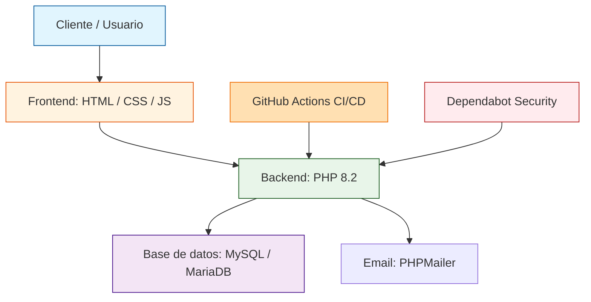

# Directo a Obra

<p align="center">
  <a href="https://github.com/Matthew-Garay/Directo-a-Obra/actions/workflows/ci.yml"></a>
  <a href="https://github.com/Matthew-Garay/Directo-a-Obra/security/dependabot"></a>
  <a href="https://github.com/Matthew-Garay/Directo-a-Obra/releases"></a>
</p>

Plataforma de comercio electrónico para compra y venta de materiales de construcción, desarrollada con PHP y MySQL. Permite navegar por un catálogo de productos, gestionar un carrito de compras, realizar pagos y contactar con proveedores.

---

## Descripción

Directo a Obra es un sistema web orientado al sector de la construcción que facilita la adquisición de materiales y herramientas. Incluye funcionalidades de catálogo de productos, detalle de artículo, carrito de compras, proceso de pago, registro de contacto y sección informativa sobre la empresa.

## Stack tecnológico

- **Backend:** PHP 8.2
- **Base de datos:** MySQL / MariaDB
- **Frontend:** HTML, CSS, JavaScript
- **Email:** PHPMailer (envío de correos)
- **Servidor local:** Apache (XAMPP)

## Arquitectura del sistema



---

## Estructura del proyecto

```
Directo a Obra/
├── .github/                # Configuración de GitHub (CI/CD, plantillas)
│   ├── workflows/
│   └── ISSUE_TEMPLATE/
├── clases/                 # Lógica de negocio y modelos
├── configuracion/          # Archivos de configuración (configproducts.php excluido por .gitignore)
├── css/                    # Hojas de estilo
├── database/               # Scripts SQL de base de datos
├── js/                     # JavaScript del frontend
├── phpmailer/              # Librería para envío de correos
├── Recursos/               # Imágenes y assets estáticos
├── .gitignore              # Archivos excluidos del control de versiones
├── .env.example            # Plantilla de variables de entorno
├── Index.php               # Página principal
├── productos.php           # Catálogo de productos
├── detalles.php            # Detalle de producto
├── carrito / checkout      # Carrito y proceso de pago
├── pago.php                # Pasarela de pago
├── completado.php          # Confirmación de compra
├── contacto.php            # Formulario de contacto
├── somos.php               # Información de la empresa
├── proveedores.php         # Gestión de proveedores
└── README.md               # Este archivo
```

## Instalación rápida

1. Clona el repositorio dentro de `htdocs` de XAMPP:
   ```bash
   git clone https://github.com/Matthew-Garay/Directo-a-Obra.git
   ```
2. Copia `.env.example` a `.env` y configura tus credenciales:
   ```bash
   cp .env.example .env
   ```
3. Importa `database/directoaobra.sql` en phpMyAdmin.
4. Configura `configuracion/configproducts.php` con tus claves de pago (archivo excluido del repositorio por seguridad).
5. Inicia Apache y MySQL desde XAMPP.
6. Accede a `http://localhost/Directo%20a%20Obra/Index.php`.

---

## Contacto

<p align="center">
  <a href="mailto:1911.garay.perez@gmail.com"></a>
  <a href="https://www.linkedin.com/in/matthewgarayperez/"></a>
</p>

<p align="center">Desarrollado por Matthew Ilveneff Garay Pérez</p>
